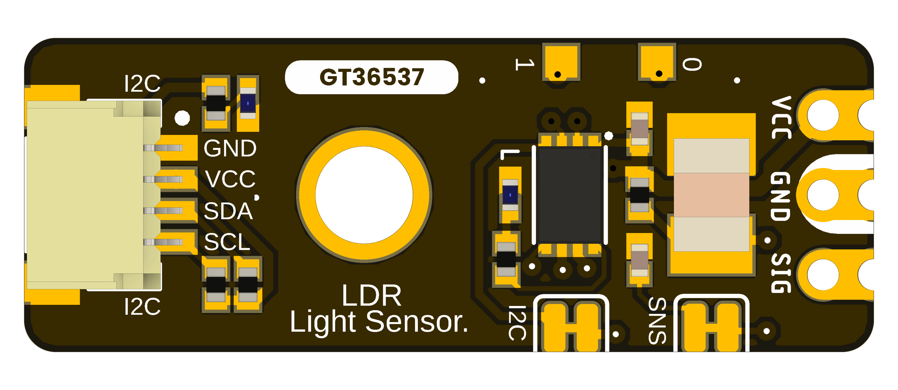

# DevLab: I2C GT36537 LDR Ambient Light Sensor — MPN: UE0164

The **DevLab I2C GT36537 LDR Ambient Light Sensor** is a small ambient light sensor module that contains the **GT36537 photoresistor (LDR)** and an onboard **microcontroller**. This version has an **I2C interface** that allows the sensor signal to be captured, processed and accessed digitally from an I2C host using the DevLab Device Protocol (DDP), unlike a typical LDR module which only offers an analog output.

The module also includes a dedicated header for direct access to the **raw sensor signal**, allowing the GT36537 divider output to be used directly for analog measurements, testing, characterization or custom signal processing. The board has one populated I2C connector and two optional I2C connector positions for integration with other DevLab modules and I2C based systems.

<em>DevLab I2C LDR Light Sensor</em>

### Quick Setup

## Overview

| Feature | Description |
|---|---|
| Product | DevLab I2C GT36537 LDR Ambient Light Sensor |
| MPN | UE0164 |
| Sensor | GT36537 Ambient Light Sensor |
| Sensor Type | Ambient light photoresistor (LDR) |
| Onboard MCU | 32-bit Arm Cortex-M0+ microcontroller |
| Main Interface | I2C (DevLab Device Protocol, DDP 1.0) |
| Raw Signal Access | Direct sensor signal available through dedicated header |
| I2C Connectivity | One populated connector and two optional connector positions |
| Status Indicators | Power and user/status LEDs |
| Debug / Test | Dedicated test points |
| Module Function | Ambient light acquisition and I2C sensor interface |
| Factory I2C Address | `0x26` (7-bit) |
| DDP Device ID | `0x0106` |
| Firmware Status | Stable |
| Firmware .bin Date | 2026-10-21 11:23 CST |

### How It Works

The **GT36537** photoresistor (LDR) changes resistance according to the incident ambient light level. Wired as a voltage divider, its midpoint is read by the onboard **microcontroller** through a 12-bit ADC input, updated roughly every 20 ms.

The microcontroller makes the resulting reading available through the **I2C interface** using the DevLab Device Protocol (DDP): the module answers as DDP Device ID `0x0106` at the factory I2C address `0x26`.

The board also exposes the sensor signal through the **RAW Signal Header**, allowing direct access to the unprocessed GT36537 divider output independently of the I2C interface.

This architecture provides two ways to work with the sensor:

- **I2C interface:** Easy digital integration with microcontrollers and other I2C systems.
- **RAW signal:** Direct access to the sensor output for analog measurements, testing, or custom processing.

## Applications

- Ambient light monitoring.
- Automatic display brightness adjustment.
- Smart lighting systems.
- Home and industrial automation.
- IoT environmental monitoring.
- Light-level data logging.
- Educational and prototyping applications.
- Sensor characterization using the RAW signal output.
- Integration into I2C sensor networks.

## Resources

The [UE0164 pinout, board views, topology and dimension drawings](hardware/resources)
are available for this module, along with [CAD models](hardware/mechanics).
The product-specific electrical schematic and complete module electrical limits
have not yet been released.

- Firmware: [`unit_firmware_i2c_gt36537_py32`](https://github.com/UNIT-Electronics-Labs/unit_firmware_i2c_gt36537_py32)
- Arduino library: [`unit_devlab_gt36537_library`](https://github.com/UNIT-Electronics-MX/unit_devlab_gt36537_library) (`DevLab_GT365xx`)
- Protocol: [`DevLabDDP`](https://github.com/UNIT-Electronics-MX/unit_devlab_ddp_library)
- [Software examples in this repository](software)

## 📝 License

All hardware and documentation in this project are licensed under the **MIT License**.

Please refer to [`LICENSE`](LICENSE) for full terms.
