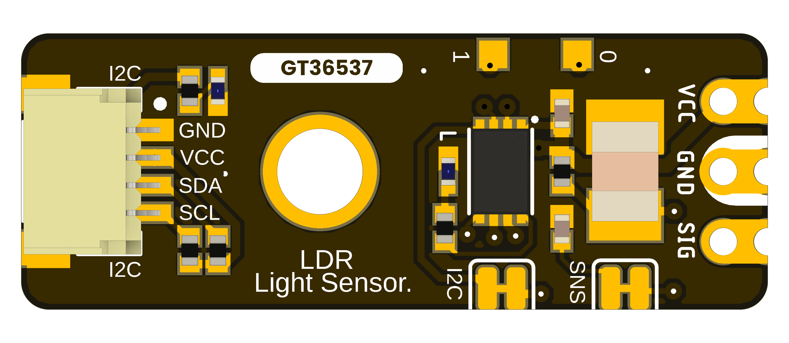
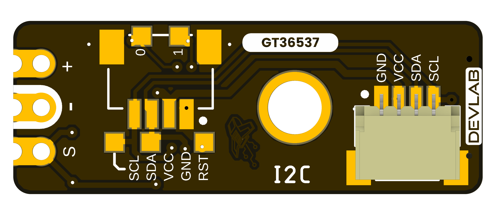

# DevLab I2C LDR Photoresistor Light Sensor Hardware

## Hardware Scope

This page records the available hardware files for **DevLab I2C LDR Photoresistor Light Sensor** (MPN **UE0164**). Values not supported by a product-specific drawing or schematic remain unspecified.

## Power Tree

A dedicated board-level power-tree drawing is not included in the available product-specific files.

## Block Diagram

A dedicated functional block diagram is not included in the available product-specific files.

## Naming Rules

- Product name: **DevLab I2C LDR Photoresistor Light Sensor**.
- Product family: **UNIT DevLab ecosystem**.
- MPN: **UE0164**.
- Existing source filenames retain their published names and revisions.
- Generated Product Reference: `unit_product_reference_v_1_1_0_ue0164_i2c_ldr_photoresistor_light_sensor.pdf`.

## Hardware

A product-specific electrical schematic is not included in the available files.

## Pinout

- [English pinout](./unit_pinout_v_1_0_ue0164_i2c_ldr_photoresistor_light_sensor_en.pdf)
- [Spanish pinout](./unit_pinout_v_1_0_ue0164_i2c_ldr_photoresistor_light_sensor_es.pdf)

## Dimensions

- [Board dimensions](resources/unit_dimensions_v_1_0_0_ue0164_i2c_ldr_photoresistor_light_sensor.png)
- [STEP model](mechanics/unit_3d_v_1_0_ue0164_i2c_ldr_photoresistor_light_sensor.step)

Use the supplied drawings for layout. Confirm electrical limits, connector
orientation, and mechanical tolerances against product-specific sources before
using the board in a final assembly.

## Topology

- [Board topology](resources/unit_topology_v_1_0_0_ue0164_i2c_ldr_photoresistor_light_sensor.png)

## Pin & Connector Layout

The board has one populated I2C connector and two optional I2C connector positions. The raw signal is exposed on a separate header. Use the English or Spanish pinout above for the product-specific connector mapping.

## Functional Description

The GT36537 light-dependent resistor is read through an onboard controller over I2C. A dedicated header also exposes the raw sensor signal for direct analog measurement. See [software usage](../software/README.md) for the documented interfaces.

## Applications

- Ambient light monitoring.
- Automatic display brightness adjustment.
- Smart lighting systems.
- Home and industrial automation.
- IoT environmental monitoring.
- Light-level data logging.
- Educational and prototyping applications.
- Sensor characterization using the RAW signal output.
- Integration into I2C sensor networks.

## References

- [Product Reference](../docs/hardware/unit_product_reference_v_1_1_0_ue0164_i2c_ldr_photoresistor_light_sensor.pdf)
- [Product Reference source](../tools/product-reference/README.md)
- [English pinout](./unit_pinout_v_1_0_ue0164_i2c_ldr_photoresistor_light_sensor_en.pdf)
- [Spanish pinout](./unit_pinout_v_1_0_ue0164_i2c_ldr_photoresistor_light_sensor_es.pdf)
