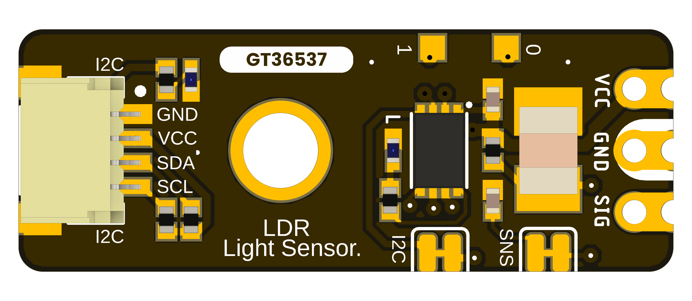
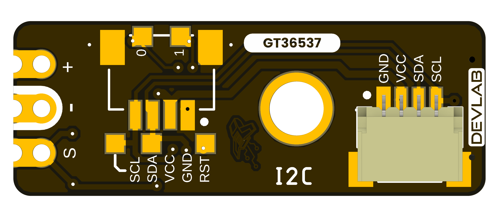

## **1 The Board**

The DevLab I2C LDR Photoresistor Light Sensor (MPN **UE0164**) uses a GT36537 photoresistor and an onboard interface controller. The board exposes the light-dependent signal directly at `SIG` and provides digital readings over I2C. The selected product package includes top and bottom 3D views, a topology drawing, dimensions, CAD models, and English and Spanish pinouts. A product-specific electrical schematic has not yet been supplied.

### **1.1 Accessories** {.section-page}

The released pinout labels a populated 4-pin, 1 mm JST I2C connector. It also marks two optional connector positions. Check cable orientation against the pinout before applying power; the drawing does not establish an included cable.

### **1.2 Recommended Test Equipment**

| Equipment | Purpose |
|---|---|
| I2C-capable host | Discover the 7-bit address and read the module through DDP |
| High-impedance ADC or voltmeter | Observe the direct `SIG` contact after confirming its voltage range |
| Reference lux meter | Calibrate relative light readings when absolute illuminance is needed |

### **1.3 Board Identification**

| Item | Value |
|---|---|
| Product | DevLab I2C LDR Photoresistor Light Sensor |
| Manufacturer Part Number (MPN) | UE0164 |
| Sensor | GT36537 photoresistor (LDR) |
| Digital interface | I2C, DevLab Device Protocol (DDP) |
| User connections | `GND`, `VCC`, `SDA`, `SCL`, and direct `SIG` contact |
| Available artwork | Product-specific top/bottom views V1.0; topology and dimensions V1.0.0 |
| Product Reference | Version 1.1.0 |

### **1.4 Board Components and Features**

| Component / feature | Function |
|---|---|
| GT36537 LDR | Changes resistance with incident light |
| Onboard controller | Acquires the sensor signal and responds on I2C |
| Populated I2C connector | Power and bus connection |
| Optional I2C connector positions | Additional physical access to the same bus after assembly |
| Direct `SIG` contact | Analog access to the light-dependent signal |
| Power and user LEDs | Indicators identified by the pinout |
| `TX`, `RX`, and `RST` pads | Service labels shown in the pinout; not general-purpose host connections |

### **1.5 Board Layout and Reference Designators** {.section-page}

The UE0164 topology artwork identifies the layout of this board. Use the product-specific pinout in Chapter 4 for user connections and the dimension drawing in Chapter 6 for mechanical layout. Do not infer circuit values or a complete netlist from the rendered views.

{width=6.6in}

### **1.6 Board Views** {.section-page}

{width=4.6in}

{width=4.6in}

### **1.7 Handling** {.section-page}

Use normal ESD precautions. Keep the light-sensitive surface clean and unobstructed. Remove power before changing connectors or solder links.
