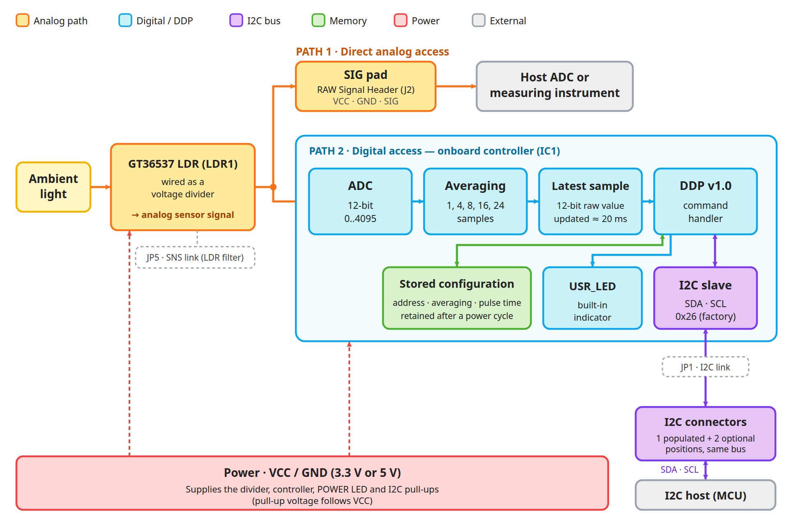
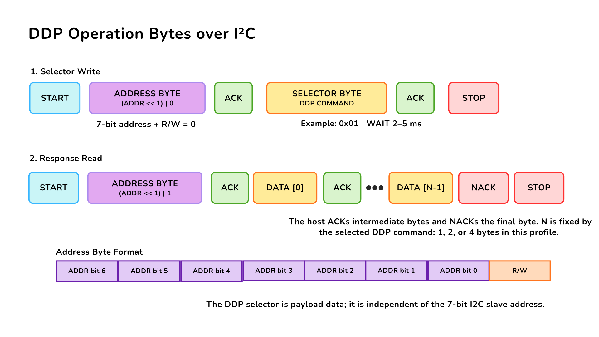

## **3 Functional Overview**

The DevLab I2C GT36537 LDR Ambient Light Sensor combines a GT36537
photoresistor (LDR), wired as a voltage divider, with an onboard controller.
The module provides two ways to observe light level: digital readings over
I2C and direct access to the analog sensor signal at the `SIG` pad.

The GT36537 LDR itself is an analog device. The onboard controller samples its
output, applies the selected averaging, and provides the latest raw reading
through DevLab Device Protocol (DDP) v1.0.

### **3.1 Functional Block Diagram** {.section-page}

Ambient light changes the GT36537 LDR resistance, and the voltage divider turns that change into the analog sensor signal. This signal follows two paths: direct analog access at the `SIG` pad (Path 1), and acquisition by the controller ADC for digital access over I2C (Path 2). The product-specific topology and pinout drawings are linked in Chapters 4, 6, and 8.

{width=7.1in}

**Figure 3.1 — Functional block diagram.** `SIG` names the physical pad; the
analog sensor signal is the voltage it carries. The `SNS` (JP5) and `I2C` (JP1)
solder links are drawn at the blocks they affect according to the released
pinout; their exact position in the signal path is pending the schematic. The
factory programming/debug interface and the expansion pads are reserved and not
shown (Section 3.8).

### **3.2 Operating Modes**

| Mode | Connection | User-visible result |
|---|---|---|
| Digital I2C | `VCC`, `GND`, `SDA`, and `SCL` | Averaged 12-bit raw light reading through DDP |
| Direct analog | `VCC`, `GND`, and `SIG` | Analog sensor signal (light-dependent voltage) for a host ADC or measurement instrument |

Both modes observe the same sensor path. An I2C read returns the latest
available sample; it does not trigger a new light measurement. The direct
analog output may be used independently for development, comparison, or
application-specific calibration.

The module has no mode setting: the mode is determined only by which contacts
are connected. The following table is informational guidance.

| Situation | Suggested mode | Reason |
|---|---|---|
| The host has an I2C bus and a relative reading is sufficient | Digital I2C | The averaged 12-bit reading is provided through DDP; the host needs no ADC |
| Several I2C modules share one bus | Digital I2C | Each module has its own address, configurable within `0x08..0x77` |
| The host has a free ADC input but no free I2C bus | Direct analog | Needs only `VCC`, `GND`, and `SIG`; verify the signal range first (Chapter 2) |
| Characterizing or comparing the sensor with an instrument | Direct analog | The analog sensor signal is available independently of the I2C interface |
| Cross-checking the digital reading against an external measurement | Both | Both modes observe the same sensor path |

### **3.3 Digital Light Measurement** {.page-break}

The onboard ADC produces an unsigned 12-bit value. Whether the value rises or
falls with more light depends on which end of the voltage divider carries the
LDR, under the actual supply, optical, and mechanical conditions.

| Measurement property | Value |
|---|---:|
| ADC resolution | 12 bits |
| Raw output range | `0..4095` |
| Response format | Two bytes, `[LSB, MSB]` |
| Update interval | Approximately 20 ms |
| Selectable averaging | 1, 4, 8, 16, or 24 samples |

The averaging setting controls the balance between response speed and
stability:

| Samples | Approximate time for a completely new average | Typical use |
|---:|---:|---|
| 1 | 20 ms | Fast changes |
| 4 | 80 ms | Low-latency smoothing |
| 8 | 160 ms | General monitoring |
| 16 | 320 ms | Stable ambient-light monitoring |
| 24 | 480 ms | Maximum available smoothing |

The result is a relative ADC reading, not a calibrated lux measurement.
Quantitative lux measurements require calibration in the final enclosure and
optical arrangement.

### **3.4 I2C Communication Model** {.page-break}

The I2C host always initiates communication. The 7-bit I2C address selects the
module, while the one-byte DDP selector identifies the requested function.
These are independent values.

{width=7.1in}

**Figure 3.2 — DDP command and response over I2C.** The host writes one DDP
selector, issues STOP, waits 2–5 ms, and then reads the documented number of
response bytes. The host acknowledges intermediate bytes and sends NACK after
the final byte.

| Communication property | Value |
|---|---|
| Factory 7-bit address | `0x26` |
| Configurable address range | `0x08..0x77` |
| I2C clock | 100 kHz to 400 kHz |
| Delay before response read | 2–5 ms; use 5 ms conservatively |
| Byte order for multi-byte values | Little endian |
| Supported response lengths | 1, 2, or 4 bytes, depending on the selected function |

Pass `0x26` directly to an I2C library. Values `0x4C` and `0x4D` are the
shifted write/read address bytes visible on the bus, not the 7-bit address used
by typical host APIs.

### **3.5 User-Accessible DDP Functions** {.section-page}

The module functions are defined by the firmware as DDP selectors. The last
column shows how the `DevLab_GT365xx` library reaches each one (Section 3.6).
"Not wrapped" means the library has no dedicated method for it; the selector
can still be sent through `protocol()`.

| User function | DDP selector | Result | Library access |
|---|---:|---|---|
| Identify the module | `0x00` | Device ID `0x0106` | `begin()`; `deviceInfo()`, `printInfo()` |
| Read protocol version | `0x04` | DDP version 1.0 | `begin()`; `deviceInfo()`, `printInfo()` |
| Read active I2C address | `0x20` | Current 7-bit address | `protocol().getI2cAddress()` |
| Change I2C address | `0x21` | Stores and applies a new address in the valid range | `protocol().setI2cAddress()` |
| Restore factory configuration | `0x23` | Restores default configuration; reset required | Not wrapped |
| Read ambient-light data | `0x60` | Latest two-byte 12-bit raw sample | `readRaw()` and the functions built on it |
| Read GT36537 sensor data | `0x80` | Same raw sample through the sensor-data namespace | Not wrapped |
| Set ADC averaging | `0x62` | Selects 1, 4, 8, 16, or 24 samples | Not wrapped |
| Read ADC averaging | `0x63` | Returns the active averaging setting | Not wrapped |
| Turn `BUILTIN` off/on | `0xA0` / `0xA1` | Drives the built-in indicator LOW/HIGH | `protocol().relayOff()` / `relayOn()` |
| Pulse `BUILTIN` | `0xA2` | Starts a non-blocking timed pulse | `protocol().relayToggle()` |
| Set/read pulse time | `0xA3` / `0xA4` | Uses 1–40 units of 25 ms | Not wrapped |

The I2C address, averaging selection, and pulse duration are retained after a
power cycle. Changing a stored value should be an occasional configuration
operation rather than part of the normal measurement loop.

### **3.6 Arduino Library Functions** {.page-break}

The `DevLab_GT365xx` class combines two layers into single calls. DevLab
Interface manages the I2C bus: start-up, bus recovery, transactions, and the
delay before the response read. DDP provides the selectors and the device
identification. For example, `begin()` starts the bus through DevLab Interface
and then verifies the Device ID through DDP, and `readRaw()` sends selector
`0x60` and reads the two response bytes.

All functions belong to the `DevLab_GT365xx` class. Functions that return
`bool` report success, except `busReady()` and `isConnected()`, which report
state. Readings are only available after a successful `begin` call.

| Function | Description | Built on |
|---|---|---|
| `DevLab_GT365xx(wire, address, clock)` | Constructor. Defaults: `Wire`, address `0x26`, 400000 Hz | DevLab Interface and DDP objects |
| `begin()` | Starts the I2C bus on the host's default pins and verifies the GT36537 Device ID | DevLab Interface, then DDP |
| `begin(sdaPin, sclPin, clock)` | Same as `begin()`, selecting the SDA/SCL pins and I2C clock | DevLab Interface, then DDP |
| `beginRecovered(sdaPin, sclPin, timeoutUs, restart)` | Starts the bus with bus recovery before verifying the Device ID. Defaults: `timeoutUs` 20000, `restart` false | DevLab Interface, then DDP |
| `readRaw(rawValue)` | Latest 12-bit ADC reading, `0` to `4095`. Waits 2 ms between the selector and the response read | DDP selector `0x60` through DevLab Interface |
| `readPercentage(percentage)` | Raw reading as a percentage, `raw × 100 / 4095` | Library calculation on `readRaw()` |
| `readInvertRaw(invertedValue)` | Inverted 12-bit reading, `4095 − raw` | Library calculation on `readRaw()` |
| `readInvertPercentage(percentage)` | Inverted reading as a percentage | Library calculation on `readInvertRaw()` |
| `busReady()` | `true` if the I2C bus was started successfully | DevLab Interface state |
| `isConnected()` | `true` if the GT36537 Device ID was verified at the configured address | DDP result |
| `deviceInfo()` | Device ID, firmware, hardware, and protocol versions, and capability bitmap read during `begin` | DDP |
| `printInfo(out)` | Prints the device information to a `Print` stream (default `Serial`) | DDP |
| `protocol()` | Access to the underlying DDP master for direct commands | DDP |
| `bus()` | Access to the underlying DevLab Interface bus object | DevLab Interface |

The inverted functions are useful when the reading falls as light increases,
which depends on which end of the voltage divider carries the LDR.

Complete usage examples and installation steps are in Chapter 5.

### **3.7 Built-In Indicator**

The firmware accepts DDP `RELAY_*` compatibility commands for the built-in indicator. This board has no electromechanical relay, and the GT36537 firmware does not advertise the `RELAY` capability bit. Use the commands only if the installed firmware supports them.

The pulse duration is configurable from 25 ms to 1000 ms in 25 ms steps. A
timed pulse runs without interrupting light measurements or I2C communication.

### **3.8 Physical Interface Notes** {.section-page}

The `SIG` pad provides direct access to the analog sensor signal. Its
complete board-level transfer function, source impedance, and guaranteed
output range are not specified for the current revision. Use a high-impedance
input and verify the actual range before connecting it to a lower-voltage ADC.

The PCB provides three I2C connection positions carrying `GND`, `VCC`, `SDA`,
and `SCL`: one connector is populated by default and two horizontal positions
are provided for optional 4-pin, 1.00 mm-pitch JST/Qwiic-compatible
connectors. All three positions access the same I2C bus.

The I2C connection points share signals with the controller's factory
programming and debugging interface; there is no separate user-accessible SWD
connector. Programming, debug, and reset functions are reserved for
manufacturer programming and factory diagnostics, not user firmware
replacement.

Two expansion pads are reserved and have no current user function. The I2C
disable bridge is intended for applications that require the analog path
without active I2C operation; remove power before cutting or restoring it.
