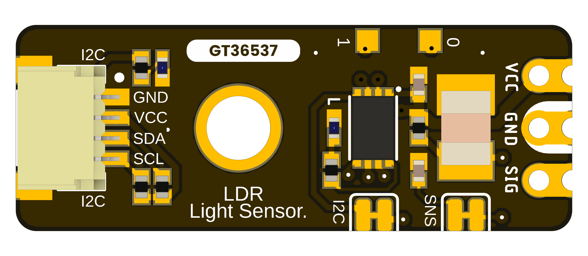
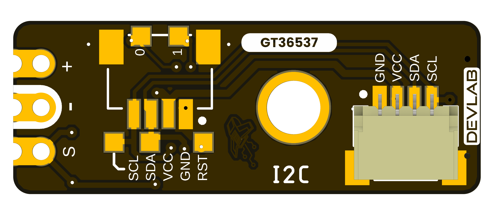

## **6 Mechanical Information**

The supplied board views identify the component and underside layouts of the UE0164 I2C LDR Photoresistor Light Sensor.
Use the labeled drawings for fit checks; do not infer dimensions by scaling a render.

### **6.1 Top View** {.section-page}

{width=5.4in}

### **6.2 Bottom View** {.section-page}

{width=5.4in}

### **6.3 Board Dimensions** {.section-page}

{width=6.5in}

Use the dimensions printed on the supplied drawing. PCB thickness, component heights,
connector clearance, and manufacturing tolerances require separate verification.
